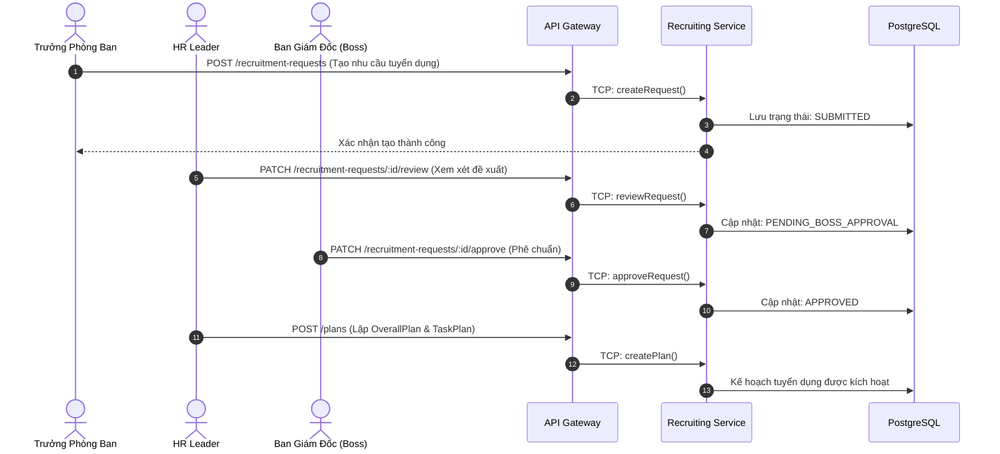
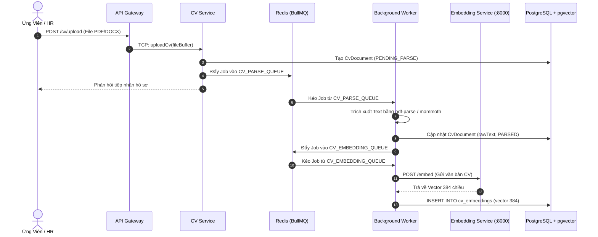

# 📖 Báo Cáo & Tài Liệu Giải Thích Toàn Diện Codebase (Backend & Frontend)

Hệ thống **RMS (Recruitment Management System)** là nền tảng quản trị và tự động hóa quy trình tuyển dụng thông minh chuẩn doanh nghiệp. Dự án áp dụng kiến trúc **Monorepo** (Turborepo), kết hợp **Microservices hướng sự kiện (Event-driven TCP RPC)**, hàng đợi bất đồng bộ **BullMQ + Redis**, cơ sở dữ liệu quan hệ **PostgreSQL** tích hợp tìm kiếm vector **pgvector**, mô hình AI ngôn ngữ nội bộ (**Local ONNX Embedding**), và giao diện người dùng **Single Page Application (React 19 + Vite + TailwindCSS)**.

---

## 📑 Mục Lục
1. [Tổng Quan Kiến Trúc Toàn Hệ Thống](#1-tổng-quan-kiến-trúc-toàn-hệ-thống)
2. [Chi Tiết Backend: Cấu Trúc, Vai Trò Từng File & Giải Thích Code](#2-chi-tiết-backend)
   - [2.1 Thư viện dùng chung (`backend/packages/`)](#21-thư-viện-dùng-chung-backendpackages)
   - [2.2 9 Microservices chuyên biệt (`backend/services/`)](#22-9-microservices-chuyên-biệt-backendservices)
3. [Chi Tiết Frontend: Cấu Trúc, Vai Trò Từng File & Giải Thích Code](#3-chi-tiết-frontend)
   - [3.1 Entry Point & Cấu Hình Cốt Lõi](#31-entry-point--cấu-hình-cốt-lõi)
   - [3.2 Quản Lý Trạng Thái, Xác Thực & API Client](#32-quản-lý-trạng-thái-xác-thực--api-client)
   - [3.3 Thành Phần Giao Diện Dùng Chung (Shared Components & UI Primitives)](#33-thành-phần-giao-diện-dùng-chung-shared-components--ui-primitives)
   - [3.4 Các Trang Công Khai & Xác Thực (`src/pages/`)](#34-các-trang-công-khai--xác-thực-srcpages)
   - [3.5 5 Phân Hệ Theo Vai Trò (`src/features/`)](#35-5-phân-hệ-theo-vai-trò-srcfeatures)
4. [Sơ Đồ Tương Tác Giữa Các Luồng Nghiệp Vụ Chính](#4-sơ-đồ-tương-tác-giữa-các-luồng-nghiệp-vụ-chính)
5. [Bảng Tra Cứu Nhanh Tất Cả Các File](#5-bảng-tra-cứu-nhanh-tất-cả-các-file)

---

## 1. Tổng Quan Kiến Trúc Toàn Hệ Thống

```mermaid
flowchart TD
    subgraph Client["Trình Duyệt Người Dùng (Frontend SPA :3000)"]
        UI_BOSS["BOSS / ADMIN Portal"]
        UI_HR["HR Leader Portal"]
        UI_DEPT["Department Head Portal"]
        UI_CAND["Candidate Portal"]
    end

    subgraph GatewayLayer["API Gateway (Port 3001)"]
        GW["API Gateway (NestJS)\n- JWT Auth Guard\n- Role-based Access Control\n- Swagger Docs\n- SSE Stream"]
    end

    subgraph InternalServices["Hệ Thống Microservices Nội Bộ (TCP Transport)"]
        SVC_ID["Identity Service\n(Port 3002 - TCP)"]
        SVC_REC["Recruiting Service\n(Port 3003 - TCP)"]
        SVC_INT["Interview Service\n(Port 3004 - TCP)"]
        SVC_CV["CV Service\n(Port 3005 - TCP)"]
        SVC_PROF["Profiles Service\n(Port 3006 - TCP)"]
        SVC_NOTIF["Notification Service\n(Port 3007 - TCP)"]
    end

    subgraph AsyncAndAI["Xử Lý Bất Đồng Bộ & AI"]
        REDIS[("Redis 7.0\n(BullMQ Queues)")]
        WORKER["Worker Service\n- cv-parse (pdf/docx)\n- cv-embedding\n- email-send (SMTP)\n- task-reminder"]
        SVC_EMBED["Embedding Service (:8000)\nONNX Runtime 384-dims"]
    end

    subgraph DataStore["Cơ Sở Dữ Liệu"]
        POSTGRES[("PostgreSQL 16 + pgvector\n(Prisma ORM)")]
    end

    Client -->|HTTP / REST / SSE / Upload| GW
    GW -->|TCP RPC| SVC_ID
    GW -->|TCP RPC| SVC_REC
    GW -->|TCP RPC| SVC_INT
    GW -->|TCP RPC| SVC_CV
    GW -->|TCP RPC| SVC_PROF
    GW -->|TCP RPC| SVC_NOTIF

    SVC_CV -->|Đẩy Job Bóc Tách| REDIS
    SVC_NOTIF -->|Đẩy Job Gửi Mail| REDIS
    SVC_REC -->|Đẩy Job Lịch Hẹn| REDIS

    REDIS -->|Kéo Job Xử Lý| WORKER
    WORKER -->|Gọi API Vector Hóa| SVC_EMBED
    WORKER -->|Lưu Text & Vector (384)| POSTGRES

    SVC_ID -->|Đọc / Ghi CSDL| POSTGRES
    SVC_REC -->|Đọc / Ghi / Cosine Search| POSTGRES
    SVC_INT -->|Đọc / Ghi CSDL| POSTGRES
    SVC_PROF -->|Đọc / Ghi CSDL| POSTGRES
```

---

## 2. Chi Tiết Backend

Backend được chia thành 2 khu vực chính:
1. `backend/packages/`: Các thư viện chia sẻ lõi dùng chung giữa các microservice.
2. `backend/services/`: 9 Microservices độc lập chịu trách nhiệm từng phân vùng nghiệp vụ riêng biệt.

---

### 2.1 Thư viện dùng chung (`backend/packages/`)

#### 🔹 `packages/contracts` (`@wr/contracts`)
> **Vai trò:** Hợp đồng dữ liệu chung duy nhất giữa Backend và Frontend, ngăn ngừa sai lệch định dạng dữ liệu (single source of truth).
- `src/enums/index.ts`:
  - `UserRole`: Định nghĩa 5 vai trò hệ thống (`BOSS`, `WEB_ADMIN`, `ADMIN`, `DEPARTMENT_HEAD`, `HR_LEADER`, `CANDIDATE`).
  - `RecruitmentStatus`: Quy trình 13 trạng thái tuyển dụng (`DRAFT`, `SUBMITTED`, `PENDING_DEPT_APPROVAL`, `PENDING_HR_APPROVAL`, `PENDING_BOSS_APPROVAL`, `APPROVED`, `REJECTED`, `CANCELLED`, `COMPLETED`, ...).
  - `PlanStatus`: Trạng thái kế hoạch tuyển dụng (`DRAFT`, `PENDING_APPROVAL`, `APPROVED`, `REJECTED`, `IN_PROGRESS`, `COMPLETED`).
  - `InterviewStatus`: Trạng thái phỏng vấn (`SCHEDULED`, `CONFIRMED`, `COMPLETED`, `CANCELLED`).
  - `ScreeningStatus`: Kết quả sàng lọc CV (`PENDING`, `PASSED_SCREENING`, `FAILED_SCREENING`).
- `src/schemas/index.ts`: Bộ schema kiểm thực dữ liệu (Zod) cho đăng nhập, đăng ký, tạo đề xuất, lập kế hoạch, tạo lịch phỏng vấn.
- `src/api/index.ts`: Định nghĩa các interface Request/Response chuẩn kiểu mẫu (DTOs).
- `src/index.ts`: Re-export toàn bộ hợp đồng dữ liệu cho các package khác import.

#### 🔹 `packages/database` (`@wr/database`)
> **Vai trò:** Quản trị cấu trúc dữ liệu, kết nối PostgreSQL, hỗ trợ kiểu dữ liệu Vector và seed dữ liệu khởi tạo.
- `prisma/schema.prisma`:
  - Mô tả đầy đủ các thực thể CSDL: `User`, `Department`, `Organization`, `RecruitmentRequest`, `OverallPlan`, `TaskPlan`, `JobPosting`, `Application`, `CvDocument`, `CvEmbedding`, `Interview`, `InterviewResult`, `AuditLog`, `SystemSetting`.
  - Cấu hình extension `postgresql` và hỗ trợ vector đa chiều phục vụ Semantic Search.
- `prisma/seed.ts` & `prisma/seed-runner.cjs`:
  - Khởi tạo tài khoản mẫu đầy đủ vai trò (Boss, Web Admin, HR Leader, Dept Head, Candidate) với mật khẩu mã hóa bcrypt, thiết lập phòng ban (Engineering, Marketing, HR, Finance).
- `prisma/seed-sample-cvs.ts`:
  - Nạp dữ liệu các file CV mẫu trong thư mục `fixtures/*.pdf`, trích xuất text và sinh sẵn vector embedding ban đầu vào CSDL.
- `migrations/sql/001_enable_pgvector.sql` & `003_create_ivfflat_index.sql`:
  - Kích hoạt extension `CREATE EXTENSION IF NOT EXISTS vector;`.
  - Thiết lập chỉ mục `ivfflat` trên cột `embedding` sử dụng khoảng cách Cosine (`vector_cosine_ops`) giúp tăng tốc truy vấn vector với hàng trăm nghìn ứng viên.
- `src/index.ts`: Khởi tạo và export đối tượng `PrismaClient` singleton phục vụ toàn bộ dịch vụ.

#### 🔹 `packages/config` (`@wr/config`)
> **Vai trò:** Nạp và kiểm định cấu hình môi trường.
- `src/index.ts`: Đọc file `.env` từ gốc dự án, dùng Zod để validate nghiêm ngặt các biến bắt buộc (`DATABASE_URL`, `REDIS_URL`, `JWT_SECRET`, `PORT`, `SMTP_*`), đảm bảo nếu thiếu cấu hình dịch vụ sẽ dừng ngay khi khởi động (Fail-fast).

#### 🔹 `packages/logger` (`@wr/logger`)
> **Vai trò:** Thư viện ghi log chuẩn hóa.
- `src/index.ts`: Đóng gói cấu hình Logger chuẩn (sử dụng Pino/Winston) cho các microservice và cung cấp hàm bọc `wrapWorkerProcessor` để tự động log thời gian thực thi, job id, và bắt lỗi trong BullMQ Worker.

#### 🔹 `packages/queue` (`@wr/queue`)
> **Vai trò:** Quản lý hàng đợi tin nhắn BullMQ và kết nối Redis.
- `src/index.ts`: Định nghĩa tên các hàng đợi:
  - `CV_PARSE_QUEUE`: Hàng đợi nhận file CV để trích xuất văn bản thô.
  - `CV_EMBEDDING_QUEUE`: Hàng đợi tính toán vector ngữ nghĩa từ văn bản CV.
  - `EMAIL_SEND_QUEUE`: Hàng đợi gửi email thông báo, mã OTP, thư mời phỏng vấn, thư mời nhận việc.
  - `TASK_REMINDER_QUEUE`: Hàng đợi quét lịch nhắc việc đến hạn.

#### 🔹 `packages/ai` (`@wr/ai`)
> **Vai trò:** Cung cấp các thuật toán trí tuệ nhân tạo, bóc tách CV, xử lý ngôn ngữ tự nhiên và tính điểm độ phù hợp.
- `src/cv-parser.ts` & `src/cv-extractor.ts`: Đọc file đính kèm dạng Buffer (PDF sử dụng `pdf-parse`, DOCX sử dụng `mammoth`), làm sạch văn bản (loại bỏ ký tự rác, chuẩn hóa khoảng trắng).
- `src/candidate-template-parser.ts`: Phân tích quy tắc (Regex/Heuristics) để nhận diện họ tên, email, số điện thoại, danh sách kỹ năng, số năm kinh nghiệm từ nội dung văn bản.
- `src/embedding.ts`: Tích hợp thư viện ONNX Tokenizer và mô hình Transformer nội bộ để biến chuỗi văn bản thành mảng vector 384 chiều (`number[]`).
- `src/similarity.ts`: Triển khai công thức toán học tính độ tương đồng Cosine giữa 2 vector $A$ và $B$:
  $$\text{Cosine Similarity} = \frac{A \cdot B}{\|A\| \|B\|}$$
- `src/matching/scorer.ts`: Tính điểm Matching tổng hợp giữa ứng viên và tin tuyển dụng (kết hợp Semantic Score từ vector + Điểm khớp kỹ năng bắt buộc + Điểm kinh nghiệm).
- `src/matching/search-expander.ts`: Mở rộng từ khóa tìm kiếm (ví dụ: tìm "React" sẽ tự động mở rộng sang "ReactJS", "NextJS", "Frontend").
- `src/skill-graph/graph.ts` & `src/skill-graph/taxonomy.ts`: Đồ thị quan hệ kỹ năng công nghệ (Skill Taxonomy Tree), ánh xạ liên kết giữa các chuyên môn liên quan.

#### 🔹 `packages/ai-models` (`@wr/ai-models`)
> **Vai trò:** Chứa mô hình AI Transformer đã được lượng tử hóa.
- `rms-embedding-model/onnx/model_quantized.onnx`: File nhị phân mô hình ONNX (`intfloat/multilingual-e5-small` đã qua tối ưu hóa INT8), cho tốc độ suy luận nhanh mà không đòi hỏi GPU chuyên dụng.
- `tokenizer.json` & `tokenizer_config.json`: Từ điển và cấu hình tách từ đa ngôn ngữ (hỗ trợ tốt cả tiếng Việt và tiếng Anh).

#### 🔹 `packages/storage` (`@wr/storage`)
> **Vai trò:** Tầng giao tiếp lưu trữ tài liệu.
- `src/index.ts`: Cung cấp hàm lưu trữ file CV vào thư mục local an toàn hoặc đẩy lên dịch vụ lưu trữ đám mây (S3 / Cloudflare R2 / Supabase Storage), kiểm soát MIME-type và giới hạn dung lượng tải lên.

---

### 2.2 9 Microservices chuyên biệt (`backend/services/`)

#### 1️⃣ API Gateway (`backend/services/gateway`)
*Cổng giao tiếp duy nhất (Port 3001) tiếp nhận toàn bộ request từ Frontend, định tuyến bảo mật và chuyển giao dữ liệu.*
- `src/main.ts`: Khởi chạy ứng dụng NestJS HTTP Server, cấu hình CORS cho phép Frontend truy cập, nạp Swagger Documentation (`/api/docs`), cài đặt Global Pipes (ValidationPipe kiểm tra DTO) và Exception Filters.
- `src/gateway.module.ts`: Khai báo kết nối NestJS `ClientsModule` qua giao thức TCP tới 6 microservices nghiệp vụ nội bộ (`IDENTITY_SERVICE`, `RECRUITING_SERVICE`, `INTERVIEW_SERVICE`, `CV_SERVICE`, `PROFILES_SERVICE`, `NOTIFICATION_SERVICE`).
- `src/auth/strategies/jwt.strategy.ts`: Kế thừa Passport JWT, tự động trích xuất Bearer Token từ Header, giải mã và xác thực token hợp lệ.
- `src/auth/decorators/guard/jwt-auth.guard.ts`: Guard bảo vệ mọi endpoint; bỏ qua nếu endpoint có gắn `@Public()`.
- `src/auth/decorators/guard/roles.guard.ts`: Guard phân quyền nâng cao, đối chiếu vai trò người dùng trong Token với mảng vai trò cho phép được gán bằng decorator `@Roles(UserRole.HR_LEADER, ...)`.
- `src/auth/decorators/roles.decorator.ts` & `current-user.decorator.ts`: Custom decorator tiện ích giúp gán quyền và lấy thông tin User hiện tại từ Request.
- `src/controllers/identity.controller.ts`: Tiếp nhận các route `/api/v1/auth/login`, `/register`, `/refresh-token`, forward TCP sang Identity Service.
- `src/controllers/recruiting.controller.ts`: Tiếp nhận các route quản lý đề xuất tuyển dụng (`/recruitment-requests`), lập kế hoạch (`/plans`), tin tuyển dụng (`/jobs`), nộp hồ sơ (`/applications`), tìm kiếm ứng viên (`/talent-search`), forward TCP sang Recruiting Service.
- `src/controllers/interview.controller.ts`, `hr-interview-results.controller.ts`, `dept-head-interview-feedback.controller.ts`: Tiếp nhận xếp lịch phỏng vấn và gửi phiếu chấm điểm.
- `src/controllers/cv.controller.ts`: Sử dụng `FileInterceptor` nhận file CV tải lên từ ứng viên/HR và chuyển stream buffer sang CV Service.
- `src/controllers/profiles.controller.ts`: Tiếp nhận quản lý hồ sơ ứng viên cá nhân.
- `src/controllers/notifications.controller.ts` & `src/services/sse-notification.service.ts`: Mở kênh truyền dữ liệu một chiều SSE (`GET /api/v1/notifications/stream`) để đẩy thông báo thời gian thực xuống giao diện người dùng mà không cần reload.
- `src/common/filters/global-exception.filter.ts`: Chuẩn hóa định dạng lỗi trả về `{ statusCode, message, timestamp, path }`.

#### 2️⃣ Identity Service (`backend/services/identity`)
*Quản lý tài khoản, danh tính, xác thực và cơ cấu tổ chức.*
- `src/main.ts`: Khởi động TCP Microservice lắng nghe các gói tin RPC từ Gateway.
- `src/modules/auth/auth.service.ts` & `auth.controller.ts`:
  - Xử lý mã hóa mật khẩu bằng `bcrypt`.
  - Sinh cặp Token: Access Token (thời hạn 1 giờ) và Refresh Token (lưu trữ trong Redis với thời hạn 7 ngày).
  - Xác thực mã OTP xác nhận tài khoản qua email.
- `src/modules/users/users.service.ts` & `users.controller.ts`: Thêm mới, cập nhật, đổi mật khẩu, phân quyền vai trò cho nhân viên.
- `src/modules/departments/` & `organizations/`: Quản lý danh mục phòng ban (IT, HR, Sales...) và cấu hình công ty.
- `src/modules/google-calendar/google-calendar.service.ts`: Kết nối Google OAuth API, tự động tạo phòng họp Google Meet và đồng bộ vào lịch cá nhân khi có lịch phỏng vấn.

#### 3️⃣ Recruiting Service (`backend/services/recruiting`)
*Trái tim nghiệp vụ quản lý toàn bộ vòng đời tuyển dụng doanh nghiệp.*
- `src/modules/recruitment-requests/recruitment-requests.service.ts`:
  - Quản lý quy trình 13 trạng thái phê duyệt đề xuất tuyển dụng: Trưởng phòng ban tạo đề xuất -> HR xem xét -> BOSS phê chuẩn -> Hoàn tất.
- `src/modules/overall-plan/overall-plan.service.ts`:
  - Lập kế hoạch tuyển dụng tổng thể (`OverallPlan`), định mức ngân sách, thời hạn và chỉ tiêu tuyển dụng cho từng chiến dịch.
- `src/modules/task-plan/task-plan.service.ts`:
  - Phân rã kế hoạch thành các đầu việc nhỏ (`TaskPlan`) giao cho từng chuyên viên HR phụ trách (sàng lọc, phỏng vấn, offer).
- `src/modules/job-postings/job-postings.service.ts`:
  - Quản trị bài đăng tuyển dụng công khai, mức lương, tiêu chuẩn công việc, trạng thái hiển thị (DRAFT / PUBLISHED / CLOSED).
- `src/modules/applications/applications.service.ts`:
  - Tiếp nhận hồ sơ ứng tuyển từ ứng viên hoặc từ HR nạp trực tiếp, liên kết ứng viên với `CvDocument`.
- `src/modules/cv-screening/cv-screening.service.ts`:
  - Tự động sàng lọc hồ sơ dựa trên điểm đối sánh AI, phân loại hồ sơ đạt/không đạt tiêu chuẩn tối thiểu.
- `src/modules/cv-search/cv-search.service.ts` & `talent-search/`:
  - Triển khai câu truy vấn SQL tìm kiếm vector ngữ nghĩa với `pgvector`:
    ```sql
    SELECT id, candidate_id, 1 - (embedding <=> $1) AS similarity_score
    FROM cv_embeddings
    ORDER BY embedding <=> $1 ASC
    LIMIT 20;
    ```
- `src/modules/evaluations/` & `hiring-decisions/`:
  - Tổng hợp điểm đánh giá các vòng phỏng vấn, trình lãnh đạo ra quyết định tuyển dụng cuối cùng.
- `src/modules/offers/offer-letter.service.ts`:
  - Phát hành thư mời nhận việc điện tử (Offer Letter), bao gồm mức lương, ngày nhận việc, thời hạn phản hồi.
- `src/modules/reports/reports.service.ts`:
  - Thống kê tỷ lệ chuyển đổi qua các vòng (Funnel Report), tính toán chi phí trên mỗi lượt tuyển thành công và xuất báo cáo thường niên cho Ban giám đốc.
- `src/modules/audit-log/`:
  - Ghi vết mọi sự kiện phê duyệt, thay đổi trạng thái, đảm bảo không thể gian lận trong quá trình tuyển chọn.

#### 4️⃣ Interview Service (`backend/services/interview`)
*Lên lịch, điều phối phòng họp và quản lý đánh giá phỏng vấn.*
- `src/modules/schedules/schedules.service.ts` & `schedules.controller.ts`:
  - Tạo phiên phỏng vấn (Vòng 1: HR Sơ loại, Vòng 2: Phỏng vấn Chuyên môn với Dept Head, Vòng 3: Văn hóa/Boss).
  - Phân bổ thành viên hội đồng phỏng vấn (Interviewers) và tránh trùng lịch.
- `src/modules/invitations/invitations.service.ts`:
  - Gửi thư mời lịch phỏng vấn đến email ứng viên và lịch Google Meet tới người phỏng vấn.
- `src/modules/results/interview-result.service.ts` & `results.controller.ts`:
  - Lưu trữ bảng điểm đánh giá chi tiết: Kỹ năng chuyên môn, kỹ năng giao tiếp, khả năng giải quyết vấn đề, kết luận khuyến nghị (PASS / FAIL / CONSIDER).

#### 5️⃣ CV Service (`backend/services/cv`)
*Tiếp nhận file tài liệu CV và khởi phát tiến trình xử lý nền.*
- `src/modules/cv/cv.service.ts` & `cv.controller.ts`:
  - Tiếp nhận buffer file CV từ Gateway, kiểm tra định dạng (.pdf, .docx), lưu trữ file, tạo bản ghi `CvDocument` với trạng thái `PENDING_PARSE`.
  - Đẩy 1 Job vào hàng đợi Redis `CV_PARSE_QUEUE` thông qua BullMQ để xử lý nền mà không làm nghẽn request HTTP của người dùng.
- `src/common/guards/plan-locked.guard.ts`:
  - Ngăn chặn việc tải thêm hoặc thay đổi CV nếu giai đoạn kế hoạch đã bị đóng/khóa.

#### 6️⃣ Profiles Service (`backend/services/profiles`)
*Quản lý hồ sơ ứng viên toàn diện.*
- `src/modules/candidate-profiles/candidate-profiles.service.ts`:
  - Lưu trữ thông tin cá nhân mở rộng của ứng viên (`CandidateProfile`): học vấn, chứng chỉ, lịch sử làm việc, kỹ năng, portfolio, đường dẫn mạng xã hội (LinkedIn/Github).
- `src/modules/documents/` & `evidence/`:
  - Quản lý các file đính kèm bổ trợ: bảng điểm, bằng đại học, thư giới thiệu, chứng chỉ ngoại ngữ.

#### 7️⃣ Notification Service (`backend/services/notification`)
*Thông báo đa kênh (Real-time SSE & Email Transactional).*
- `src/modules/notifications/notifications.service.ts`:
  - Tạo bản ghi thông báo trong CSDL cho người dùng, gửi tín hiệu sang API Gateway để stream qua SSE.
- `src/modules/notifications/email-template.service.ts`:
  - Soạn thảo và chuẩn hóa nội dung email HTML theo các mẫu chuẩn (Xác nhận OTP, Thư mời phỏng vấn, Thư từ chối lịch sự, Thư nhận việc - Offer Letter).
  - Đẩy Job gửi email vào BullMQ `EMAIL_SEND_QUEUE`.

#### 8️⃣ Worker Service (`backend/services/worker`)
*Xử lý tác vụ nặng chạy nền độc lập hoàn toàn bằng BullMQ Worker.*
- `src/main.ts`: Khởi chạy 4 BullMQ Workers riêng biệt kết nối Redis, cấu hình cơ chế tự động thử lại khi lỗi (`stalledInterval`, `backoff`).
- `src/processors/cv-parse.processor.ts`:
  - Nhận job từ `CV_PARSE_QUEUE`, đọc file CV, trích xuất chuỗi văn bản bằng `@wr/ai`, lưu kết quả văn bản thô vào `CvDocument.rawText`.
  - Ngay sau khi bóc tách xong, tự động đẩy tiếp 1 Job vào `CV_EMBEDDING_QUEUE`.
- `src/processors/cv-embedding.processor.ts`:
  - Nhận nội dung text, gọi sang dịch vụ Embedding để lấy mảng vector 384 chiều, sau đó thực hiện lệnh SQL lưu vector vào bảng `cv_embeddings` của PostgreSQL.
- `src/processors/email-send.processor.ts`:
  - Nhận job từ `EMAIL_SEND_QUEUE`, cấu hình transporter SMTP (Nodemailer), thực hiện gửi mail thực tế đến người nhận với cơ chế kiểm soát lỗi đường truyền.
- `src/processors/task-reminder.processor.ts`:
  - Chạy quét định kỳ (Cron Job), tìm kiếm các lịch phỏng vấn diễn ra trong vòng 24 giờ tới hoặc các Task sắp hết hạn để tự động gửi thông báo nhắc nhở.

#### 9️⃣ Embedding Service (`backend/services/embedding`)
*Dịch vụ trí tuệ nhân tạo chuyên trách tạo Vector nhúng chạy tại chỗ (Port 8000).*
- `server.mjs`:
  - Máy chủ HTTP Node.js nhẹ, phục vụ 2 endpoint:
    - `GET /health`: Kiểm tra trạng thái mô hình và số chiều vector (`EMBEDDING_DIMENSIONS = 384`).
    - `POST /embed`: Tiếp nhận chuỗi văn bản (`text`), nạp qua tokenizer của `@wr/ai`, chạy qua mô hình ONNX nội bộ và trả về mảng vector số thực 384 chiều.
  - Hoạt động offline hoàn toàn, không phụ thuộc vào API bên ngoài (OpenAI/HuggingFace), đảm bảo bảo mật dữ liệu nhân sự tuyệt đối.

---

## 3. Chi Tiết Frontend

Ứng dụng Frontend là một Single Page Application (SPA) hiện đại được xây dựng bằng **React 19**, **Vite**, **TailwindCSS**, và **Radix UI**, đặt tại thư mục [frontend/](file:///d:/Project/SE20A05Group7RMS/frontend).

---

### 3.1 Entry Point & Cấu Hình Cốt Lõi

- `frontend/index.html`: Khung HTML khởi thủy của ứng dụng, nạp bộ font Inter, thiết lập tiêu đề và thẻ gắn React `<div id="root"></div>`.
- `frontend/vite.config.ts`:
  - Thiết lập cổng chạy phát triển `3000`.
  - Cấu hình Alias `@/` trỏ vào thư mục `frontend/src/`.
  - Cấu hình Proxy chuyển tiếp: mọi request bắt đầu bằng `/api` sẽ được chuyển tự động sang `http://localhost:3001` (API Gateway), giải quyết triệt để vấn đề CORS khi phát triển cục bộ.
- `frontend/package.json`: Khai báo package name `@wr/webapp`, chứa các thư viện: `@radix-ui/*`, `lucide-react`, `recharts`, `tailwindcss`, `react-router-dom`, `clsx`, `tailwind-merge`.
- `frontend/src/main.tsx`: File điểm vào thực thi React, gọi `ReactDOM.createRoot` gắn component `App` vào DOM.
- `frontend/src/index.css`: Cấu hình Tailwind directives (`@tailwind base; components; utilities;`), khai báo các biến màu sắc CSS Design Tokens (màu primary, background, card, border cho giao diện hiện đại).
- `frontend/src/App.tsx`:
  - Bộ định tuyến trung tâm (Router) với hơn 30 routes được cấu hình bằng `react-router-dom`.
  - Sử dụng component `HomeRedirect` để tự động điều hướng người dùng sau khi đăng nhập về đúng Dashboard theo vai trò của họ.
  - Sử dụng `ProtectedRoute` để bảo vệ từng phân hệ riêng biệt.

---

### 3.2 Quản Lý Trạng Thái, Xác Thực & API Client

- `src/context/AuthContext.tsx`:
  - `AuthProvider` bao bọc toàn bộ ứng dụng, quản lý trạng thái: `user` (thông tin tài khoản và vai trò), `token` (JWT Access Token), `isLoading`.
  - Cung cấp các phương thức toàn cục: `login(email, password)`, `logout()`, `refreshUser()`.
  - Tự động kiểm tra tính hợp lệ của token lưu trong `localStorage` khi người dùng F5 tải lại trang.
- `src/components/ProtectedRoute.tsx`:
  - Lớp bảo vệ tuyến đường (Route Guard).
  - Kiểm tra xem người dùng đã đăng nhập chưa; nếu chưa, chuyển hướng về trang `/login`.
  - Kiểm tra xem vai trò của người dùng (`user.role`) có nằm trong danh sách `allowedRoles` được cấp phép cho trang đó hay không; nếu không, chuyển hướng tới `/unauthorized`.
- `src/lib/auth.ts`:
  - Tiện ích đọc, ghi và xóa `accessToken` từ `localStorage`.
- `src/lib/api.ts`:
  - Module gửi HTTP request trung tâm sử dụng hàm `fetch()`.
  - Tự động gắn header `Authorization: Bearer <accessToken>` vào mọi request nếu đã đăng nhập.
  - Bắt các lỗi HTTP (401, 403, 500) và ném ra đối tượng lỗi có cấu trúc dễ xử lý.
- `src/lib/errors.ts`:
  - Chuyển đổi mã lỗi từ backend thành các thông điệp tiếng Việt thân thiện, dễ hiểu trên giao diện.
- `src/lib/utils.ts`:
  - Cung cấp hàm tiện ích `cn(...inputs)` kết hợp giữa `clsx` và `tailwind-merge` để dễ dàng gộp và ghi đè class Tailwind linh hoạt.
- `src/lib/planStatus.ts`:
  - Định nghĩa màu sắc nhãn (Badge variant/color) tương ứng với từng trạng thái kế hoạch tuyển dụng.

---

### 3.3 Thành Phần Giao Diện Dùng Chung (Shared Components & UI Primitives)

- `src/components/Layout.tsx`:
  - Khung bố cục chuẩn (App Shell) cho các màn hình đã đăng nhập.
  - Tích hợp thanh Sidebar định hướng (menu thay đổi tự động theo vai trò người dùng), Header trên cùng hiển thị Breadcrumbs, chuông thông báo (kết nối SSE) và Avatar người dùng với menu Đăng xuất / Cài đặt tài khoản.
- `src/components/JobDetailsModal.tsx`:
  - Hộp thoại Modal xem chi tiết tin tuyển dụng: yêu cầu công việc, mức đãi ngộ, quyền lợi, và tích hợp sẵn form nộp hồ sơ CV trực tuyến cho ứng viên.
- `src/components/ui/*`:
  - Bộ linh kiện UI nguyên tử (Atomic Primitives) chuẩn thiết kế Radix UI:
    - `button.tsx`: Nút bấm với nhiều biến thể (default, destructive, outline, secondary, ghost, link).
    - `input.tsx` & `textarea.tsx`: Các ô nhập liệu văn bản với kiểu viền và focus mượt mà.
    - `combobox.tsx`: Hộp chọn kết hợp tìm kiếm nhanh dữ liệu.
    - `sheet.tsx`: Ngăn kéo trượt từ cạnh màn hình (thường dùng cho menu mobile hoặc panel chi tiết).
    - `sidebar.tsx`: Hệ thống khung Sidebar điều hướng có thể thu gọn/mở rộng.
    - `skeleton.tsx`: Khung xương giả lập trạng thái đang tải dữ liệu (loading placeholder).
    - `tooltip.tsx`: Hộp gợi ý ngắn khi rê chuột vào biểu tượng.
    - `separator.tsx`: Đường phân cách trực quan giữa các khối nội dung.

---

### 3.4 Các Trang Công Khai & Xác Thực (`src/pages/`)

- `src/pages/LandingPage.tsx`: Trang chủ công khai dành cho tất cả mọi người, hiển thị banner giới thiệu thương hiệu, danh sách vị trí đang tuyển dụng và nút nộp hồ sơ nhanh.
- `src/pages/Login.tsx`: Form đăng nhập với email và mật khẩu, hỗ trợ ghi nhớ đăng nhập, chuyển hướng thông minh theo quyền hạn.
- `src/pages/SignUp.tsx`: Đăng ký tài khoản dành cho ứng viên mới ứng tuyển vào doanh nghiệp.
- `src/pages/EmailOtpVerification.tsx`: Màn hình nhập mã xác thực OTP 6 số được gửi qua email để kích hoạt tài khoản.
- `src/pages/ForgotPassword.tsx` & `src/pages/ResetPassword.tsx`: Quy trình yêu cầu gửi link quên mật khẩu và đặt lại mật khẩu mới.
- `src/pages/AccountSettings.tsx`: Cho phép người dùng cập nhật họ tên, số điện thoại, tải lên ảnh đại diện (Avatar) và đổi mật khẩu mới.
- `src/pages/Unauthorized.tsx`: Màn hình hiển thị lỗi từ chối truy cập (HTTP 403) khi người dùng cố tình truy cập vào trang không thuộc thẩm quyền của vai trò mình.

---

### 3.5 5 Phân Hệ Theo Vai Trò (`src/features/`)

Hệ thống phân chia giao diện nghiệp vụ thành 5 phân hệ tương ứng với từng nhóm người dùng:

```
frontend/src/features/
├── admin/          # Dành cho BOSS (Lãnh đạo) & WEB_ADMIN (Kỹ thuật)
├── dept-head/      # Dành cho Trưởng phòng ban chuyên môn (Department Head)
├── hr/             # Dành cho Trưởng nhóm & Chuyên viên Nhân sự (HR Leader / Recruiter)
└── candidate/      # Dành cho Ứng viên tìm việc (Candidate)
```

#### 👑 1. Phân hệ BOSS & System Admin (`src/features/admin/`)
- `AdminDashboardShell.tsx` & `AdminDashboard.tsx`: Bảng điều khiển cấp cao cho lãnh đạo doanh nghiệp, xem tổng quan số lượng đề xuất, tiến độ tuyển dụng toàn công ty và ngân sách đã sử dụng.
- `AdminApprovalQueue.tsx`: Hàng đợi các đề xuất tuyển dụng (`PENDING_BOSS_APPROVAL`) và kế hoạch tổng thể (`OverallPlan`) đang chờ lãnh đạo phê duyệt trực tiếp chỉ với 1 click.
- `AdminAllRequests.tsx`: Danh sách toàn diện lịch sử các đề xuất tuyển dụng từ mọi phòng ban.
- `AdminInterviewResults.tsx`: Theo dõi tổng thể kết quả phỏng vấn các vòng và danh sách nhân sự được đề xuất tuyển chọn.
- `AdminUsers.tsx`: Màn hình quản lý người dùng, tạo tài khoản cho nhân viên, kích hoạt/khóa tài khoản, phân quyền vai trò.
- `AdminAnnualReport.tsx` & `AdminDeptStats.tsx`: Báo cáo biểu đồ chi tiết (sử dụng Recharts) về hiệu suất tuyển dụng hàng năm và phân bổ nhân sự theo từng phòng ban.
- `AdminApiMonitor.tsx`: Bảng điều khiển kỹ thuật giám sát tình trạng hoạt động (Healthcheck Uptime), độ trễ (latency) của từng Microservice và kết nối Redis/Postgres.
- `AdminMaintenance.tsx`: Cho phép Admin bật chế độ bảo trì toàn hệ thống khi nâng cấp hạ tầng.
- `AdminSettings.tsx`: Cấu hình các thông số hệ thống, thời gian hết hạn của token, chính sách bảo mật.

#### 👔 2. Phân hệ Trưởng Phòng Ban (`src/features/dept-head/`)
- `DeptHeadDashboardShell.tsx` & `DeptHeadDashboard.tsx`: Bảng điều khiển riêng của trưởng bộ phận, theo dõi nhu cầu nhân sự nội bộ phòng mình.
- `DeptHeadCreateRequest.tsx`: Giao diện tạo mới một đề xuất tuyển dụng nhân sự (chọn chức danh, số lượng cần tuyển, lý do tuyển, yêu cầu chuyên môn, mức lương dự kiến).
- `requestTemplates.ts`: Định nghĩa các mẫu yêu cầu tuyển dụng tạo sẵn (ví dụ: Senior Backend Engineer, Frontend React Developer, Product Owner) giúp Trưởng phòng tạo nhanh đề xuất mà không cần gõ lại từ đầu.
- `DeptHeadRequests.tsx`: Theo dõi danh sách các đề xuất tuyển dụng của phòng mình và trạng thái phê duyệt qua từng cấp.
- `DeptHeadInterviews.tsx`: Danh sách các buổi phỏng vấn mà Trưởng phòng tham gia với tư cách Người đánh giá chuyên môn.
- `DeptHeadInterviewFeedback.tsx`: Biểu mẫu nhập kết quả đánh giá ứng viên sau phỏng vấn: chấm điểm kỹ năng cứng, giải quyết bài toán kỹ thuật, nhận xét ưu/nhược điểm và chọn kết luận Khuyến nghị tuyển / Không tuyển.
- `DeptHeadSettings.tsx`: Cài đặt lịch rảnh để nhận lịch phỏng vấn và thông báo.

#### 🎯 3. Phân hệ Nhân Sự HR (`src/features/hr/`)
- `HRDashboardShell.tsx` & `HRDashBoard.tsx`: Bảng điều khiển trung tâm của chuyên viên nhân sự: tổng số CV tiếp nhận trong tuần, số lịch phỏng vấn sắp tới, số lượng offer đang chờ phản hồi.
- `HRRequestQueue.tsx`: Tiếp nhận các đề xuất tuyển dụng đã được Ban giám đốc duyệt để chuẩn bị đưa vào kế hoạch thực thi.
- `HRTaskPlanner.tsx`: Lập kế hoạch tuyển dụng chi tiết: tạo `OverallPlan`, giao `TaskPlan` cho từng HR Recruiter, thiết lập thời hạn kết thúc.
- `HRCampaigns.tsx` & `HRCampaignDetail.tsx`: Quản lý các chiến dịch tuyển dụng, theo dõi phễu ứng viên (Ứng tuyển -> Qua sàng lọc -> Phỏng vấn -> Offer -> Onboarding).
- `HRJobPostingWorkspace.tsx`: Không gian soạn thảo tin tuyển dụng, chỉnh sửa yêu cầu công việc, xuất bản bài đăng lên cổng thông tin tuyển dụng.
- `CandidateSearch.tsx`: Công cụ tìm kiếm ứng viên thông minh: tích hợp tìm kiếm theo độ tương đồng ngữ nghĩa AI (Semantic Vector Search qua `pgvector`), lọc theo kỹ năng và kinh nghiệm.
- `HRTalentPool.tsx`: Kho lưu trữ tài năng (Talent Pool) của doanh nghiệp, giúp tái sử dụng hồ sơ các ứng viên tiềm năng cho các chiến dịch tương lai.
- `HRInterviewSchedule.tsx` & `HRInterviewDetail.tsx`: Bảng điều phối lịch phỏng vấn (dạng Calendar/List), chọn hội đồng phỏng vấn, tạo phòng họp Google Meet tự động.
- `HRInterviewResults.tsx`: Tổng hợp kết quả đánh giá từ tất cả người phỏng vấn để ra quyết định mời làm việc.
- `HRPipelineReports.tsx`: Báo cáo tỷ lệ chuyển đổi chi tiết qua từng vòng phỏng vấn, thời gian trung bình để tuyển dụng một vị trí (Time-to-hire).
- `HRSystemNotifications.tsx`: Xem toàn bộ thông báo hệ thống và lời nhắc việc đến hạn.

#### 🎓 4. Phân hệ Ứng Viên (`src/features/candidate/`)
- `CandidateDashboardShell.tsx` & `CandidateDashboard.tsx`: Bảng điều khiển cá nhân của ứng viên, hiển thị tiến độ xử lý của các đơn ứng tuyển đã nộp.
- `CandidateProfile.tsx`: Quản lý hồ sơ cá nhân hoàn chỉnh: thông tin liên hệ, mục tiêu nghề nghiệp, trình độ học vấn, kinh nghiệm dự án và danh sách kỹ năng chuyên môn.
- `CandidateUploadCv.tsx`: Trang tải lên file CV (hỗ trợ .pdf và .docx dung lượng tối đa 10MB); tự động kích hoạt tiến trình bóc tách và phân tích năng lực.
- `CandidateInterviewDetails.tsx`: Xem chi tiết thông tin buổi phỏng vấn: thời gian, hình thức (Online/Offline), link phòng họp Google Meet và những lưu ý cần chuẩn bị.
- `CandidateOffers.tsx` & `CandidateOfferDetails.tsx`: Nhận và xem chi tiết Thư mời làm việc (Offer Letter) chính thức từ công ty: vị trí, mức lương, ngày bắt đầu công việc; cho phép ứng viên bấm **Đồng ý nhận việc** hoặc **Từ chối** trực tuyến.
- `CandidateNotifications.tsx`: Trung tâm thông báo nhận tin tức cập nhật trạng thái hồ sơ của ứng viên.

---

## 4. Sơ Đồ Tương Tác Giữa Các Luồng Nghiệp Vụ Chính

### 4.1 Luồng Đề Xuất & Phê Duyệt Tuyển Dụng (13 Trạng Thái)


### 4.2 Luồng Tải Lên CV, Bóc Tách Tự Động & Vector Hóa AI


---

## 5. Bảng Tra Cứu Nhanh Tất Cả Các File

| Khu Vực | Đường Dẫn File | Vai Trò & Chức Năng Chính |
| :--- | :--- | :--- |
| **Contracts** | `backend/packages/contracts/src/enums/index.ts` | Khai báo các enum hệ thống: Role, RecruitmentStatus, PlanStatus, InterviewStatus... |
| **Contracts** | `backend/packages/contracts/src/schemas/index.ts` | Zod validation schemas cho dữ liệu đầu vào |
| **Database** | `backend/packages/database/prisma/schema.prisma` | Cấu trúc CSDL PostgreSQL & định nghĩa bảng Vector |
| **Database** | `backend/packages/database/prisma/seed.ts` | Script nạp tài khoản mẫu, phòng ban ban đầu |
| **AI** | `backend/packages/ai/src/cv-parser.ts` | Bóc tách text từ PDF (`pdf-parse`) và Word (`mammoth`) |
| **AI** | `backend/packages/ai/src/embedding.ts` | Sinh vector ngữ nghĩa từ văn bản bằng mô hình ONNX |
| **AI** | `backend/packages/ai/src/similarity.ts` | Hàm tính độ tương đồng Cosine giữa 2 vector |
| **AI** | `backend/packages/ai/src/matching/scorer.ts` | Thuật toán chấm điểm Match Score giữa CV và JD |
| **Queue** | `backend/packages/queue/src/index.ts` | Khai báo danh sách hàng đợi Redis BullMQ và kiểu dữ liệu Job |
| **Gateway** | `backend/services/gateway/src/main.ts` | Entry point API Gateway (Port 3001), CORS, Swagger |
| **Gateway** | `backend/services/gateway/src/auth/decorators/guard/jwt-auth.guard.ts` | Guard kiểm tra JWT Token cho mọi endpoint |
| **Gateway** | `backend/services/gateway/src/auth/decorators/guard/roles.guard.ts` | Guard phân quyền theo vai trò người dùng |
| **Gateway** | `backend/services/gateway/src/services/sse-notification.service.ts` | Kênh Server-Sent Events (SSE) đẩy thông báo real-time |
| **Identity** | `backend/services/identity/src/modules/auth/auth.service.ts` | Xác thực đăng nhập, băm mật khẩu bcrypt, sinh JWT & Refresh Token |
| **Identity** | `backend/services/identity/src/modules/google-calendar/` | Tích hợp Google Calendar tạo phòng họp Google Meet tự động |
| **Recruiting**| `backend/services/recruiting/src/modules/recruitment-requests/` | Quản lý quy trình 13 trạng thái phê duyệt đề xuất tuyển dụng |
| **Recruiting**| `backend/services/recruiting/src/modules/overall-plan/` | Lập kế hoạch tổng thể chiến dịch tuyển dụng |
| **Recruiting**| `backend/services/recruiting/src/modules/cv-search/` | Tìm kiếm ngữ nghĩa ứng viên sử dụng truy vấn vector pgvector |
| **Recruiting**| `backend/services/recruiting/src/modules/offers/` | Quản lý và phát hành thư mời nhận việc (Offer Letter) |
| **Interview** | `backend/services/interview/src/modules/schedules/` | Lập lịch phỏng vấn và phân bổ người phỏng vấn |
| **Interview** | `backend/services/interview/src/modules/results/` | Ghi nhận bảng điểm và nhận xét ứng viên sau phỏng vấn |
| **CV** | `backend/services/cv/src/modules/cv/` | Tiếp nhận file upload và đẩy job xử lý sang BullMQ |
| **Worker** | `backend/services/worker/src/processors/cv-parse.processor.ts` | Xử lý bóc tách text CV chạy ngầm |
| **Worker** | `backend/services/worker/src/processors/cv-embedding.processor.ts` | Xử lý tính toán vector và lưu vào PostgreSQL |
| **Worker** | `backend/services/worker/src/processors/email-send.processor.ts` | Xử lý gửi email thực tế qua giao thức SMTP |
| **Embedding** | `backend/services/embedding/server.mjs` | Dịch vụ AI nội bộ Port 8000 chạy mô hình ONNX |
| **Frontend** | `frontend/src/App.tsx` | Router ứng dụng SPA React 19, ánh xạ các route theo 5 vai trò |
| **Frontend** | `frontend/src/context/AuthContext.tsx` | Quản lý state đăng nhập, phiên người dùng và token |
| **Frontend** | `frontend/src/components/ProtectedRoute.tsx` | Component bảo vệ đường dẫn theo phân quyền vai trò |
| **Frontend** | `frontend/src/components/Layout.tsx` | Bố cục chuẩn gồm Sidebar thông minh, Header, chuông thông báo |
| **Frontend** | `frontend/src/features/admin/pages/` | Các màn hình của Ban Giám Đốc (BOSS) & Admin Kỹ thuật |
| **Frontend** | `frontend/src/features/dept-head/pages/` | Các màn hình dành cho Trưởng phòng ban (Tạo đề xuất, Phỏng vấn) |
| **Frontend** | `frontend/src/features/hr/pages/` | Các màn hình dành cho HR (Lập kế hoạch, Đăng tin, Tìm kiếm AI, Offer) |
| **Frontend** | `frontend/src/features/candidate/pages/` | Các màn hình dành cho Ứng viên (Upload CV, Xem lịch, Nhận Offer) |

---
*Tài liệu được xây dựng nhằm chuẩn hóa và hướng dẫn chi tiết toàn bộ kiến trúc mã nguồn của hệ thống RMS.*

